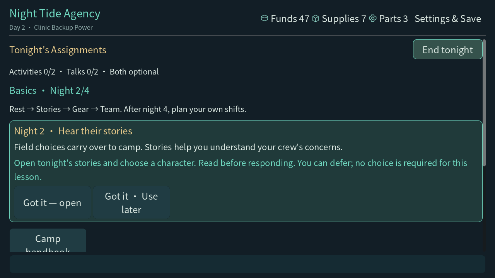
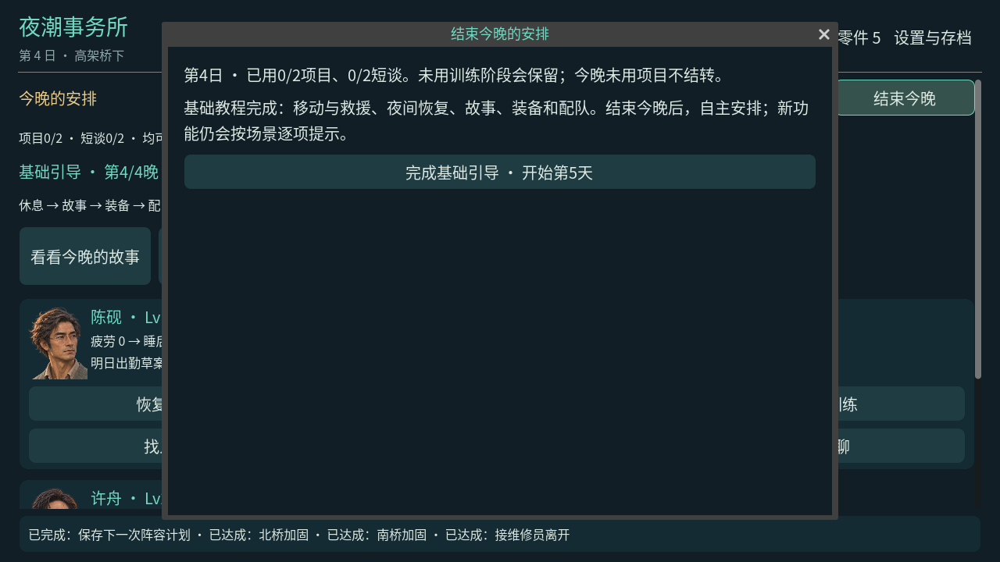
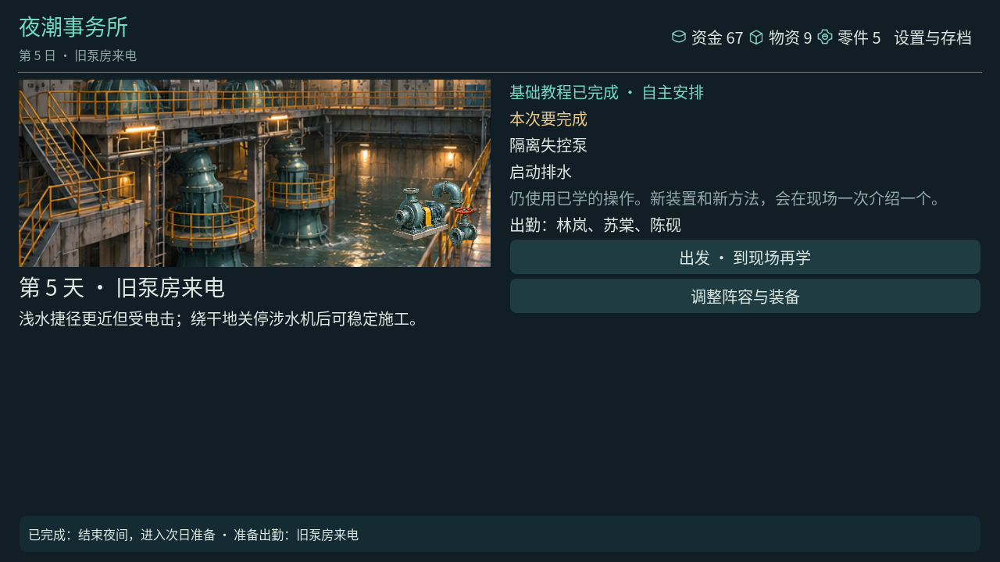

# 营地分步引导返修 · 2026-11-17

用户要求补全第二晚之后的教学，明确基础教程结束节点，后续功能按场景介绍。这次修改直接作用于正式营地和存档，不是独立演示。唯一设计权威、角色获取、经济、经验与设施数值均未修改；P4整体品质仍未通过最终验收。

| 阶段 | 默认画面与学习目的 | 玩家如何继续 |
| --- | --- | --- |
| 第一场与第一晚 | 沿用移动、预告、救援和夜间恢复教学 | 实际行动推进；夜间项目可不安排 |
| 第二晚 | 只新增故事：理解伙伴的顾虑、阅读后再回应 | 了解并打开，或明白后稍后再用；无需选剧情分支 |
| 第三晚 | 只新增已有装备：把撬棍/医疗包分配给队员 | 独立已有装备页，不出现采购与四种设施 |
| 第四晚 | 陈砚按原规则加入后，介绍下一班配队和疲劳轮换 | 可保留原阵容；结束夜晚时确认基础教学完成 |
| 第5天起 | 明确显示基础教程完成，保持已学入口 | 战场仍按现场逐项介绍；营地通常每晚只推荐一个新功能 |

基础教学的完成记录在第四晚结束的正式命令提交后才写入。打开总结、取消预览、阅读说明都不会提前完成，也不发经验、资源或额外角色。漏看的基础说明会在夜间总结中逐项补上；无需为了教程花钱、训练或选择剧情。没有同时展开全部营地功能。

后续按照实际用途提示：物资不足时补给；有人受伤时介绍医务室；关系紧张时查看条件；真实满足师生收益/合作/共同贡献条件才提示带教；多人疲劳时介绍批量项目和休息区；拥有工具时学习药品准备；达到原解锁与资源条件后逐件了解新工具。每个设施都有自己的介绍和独立页面。城市、回看约定、证据整理、公开信息、最终路线也分开进入，不再共用一个堆满按钮的“更多事务”。

有截止日期的现场支援和第23晚最终路线优先提示，已学后保留醒目的当晚提醒，避免被每晚一项的节奏遮住。玩家可主动打开营地手册，查阅当前可用功能；关闭手册不关闭后续教学。已学带教入口在条件不再满足时显示具体资格和状态检查说明，避免空白页面。已学入口可重复阅读，不再占用“今晚介绍一个新功能”的名额。

新周目保存可选的camp_lessons元数据。此前没有该字段的旧存档保留原营地入口，不突然强制重学；要体验完整的新教学节奏请使用新周目。显式跳过教学或关闭引导仍保留原有行为。没有提高runtime_revision，也不重发角色或奖励。

连续走到第5场时发现并修复了原“下一步”提示的两个缺口：最后一名队员剩余行动点不足以穿过水路时，提示结束回合；当前队员被伙伴挡住时，寻找确实可以推进的另一位队员。另修复嵌套窗口关闭后对已释放父窗口的捕获，防止回看说明时产生运行错误。

视觉复查曾发现英文24字号将教学按钮挤到首屏下方，已压缩营地顶部说明并把教学卡提前。三语三字号检查现在同时验证教学按钮在首屏可见，不只核对文字存在。

本轮剩余边界：实际连续证据只覆盖新周目M01–M05；更晚的设施期限、带教和最终路线为明确标注的隔离状态复核，不是完整24日新手游玩。三语译文已补，但完整剧本母语自然度、后期专长的决策价值、整体美术/剧情/音乐品质仍需继续打磨。检查与导出不会撤销用户对旧Windows品质的否定反馈。
