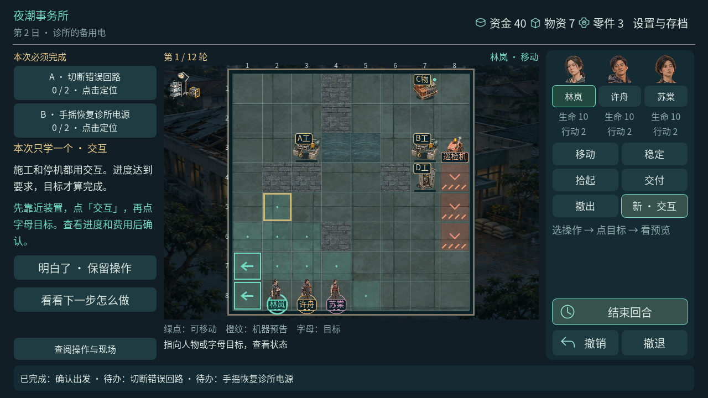
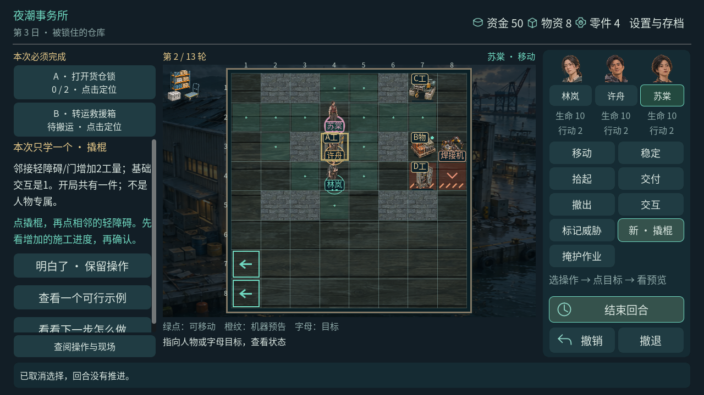
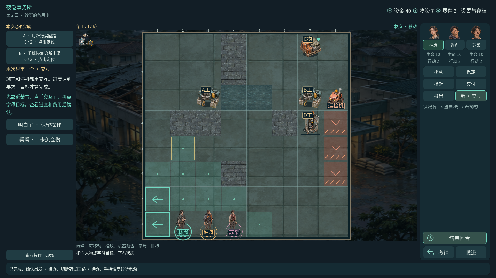
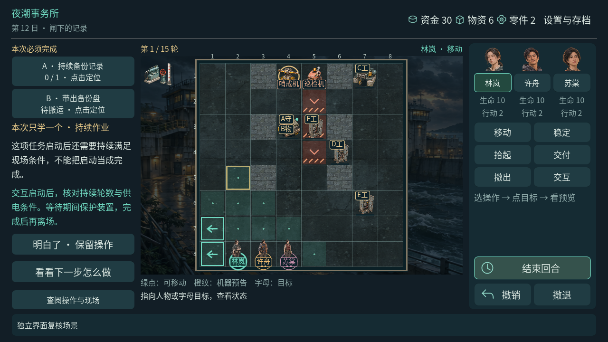

# 第二场之后的教学与战术辨识返修

2026-11-17，候选 p4fieldguide-20261117。用户要求继续打磨第二场之后的逐项引导和战术画面。本轮修改的是同一个正式 Godot 工程的呈现、操作入口和可选教学记忆；冻结设计、角色入队、成长、行动费用、胜负条件、关卡、对白与配乐未改。P4-018-01仍打开，不将检查通过写成品质达标或可以发行。

## 玩家会直接遇到的变化

| 原来的问题 | 本轮行为 | 实际入口与证据 |
| --- | --- | --- |
| M01结束后，M02立即展开全部普通操作、专长、工具、协作 | 已学过的操作保留；默认一次只出现一个新功能，解释用途和用法；真实使用或主动阅读才记住。读完后至少留一次熟悉的行动，不立即接着塞下一张说明 | M01→M04连续正式周目，fieldguide-review-gpu.json记录具体日期、回合、角色、教学与命令 |
| 准备页一次展开阵容、装备、后勤、关系等全部选项 | 默认先显示本关目标、三名出勤队员和出发按钮；「调整阵容与装备」由玩家主动展开，返回后继续教学 | 第二天简明准备、完整准备截图；不会因查看准备细节而关闭教学 |
| 工具/专长虽解锁，却不知道何时有用 | 根据当前选中人物、可用次数、装备、距离、场景和正式规则寻找可行机会。撬棍只在轻障碍可用时介绍；跨越在有障碍可跨时介绍；新人的专长仍要实际入队并满足等级 | 连续第三场在仓库轻障碍旁介绍并实际使用撬棍；第二场实际使用掩护作业。建议与示例都走正式 reducer |
| 护送和持续作业像普通施工，启动容易被误认成完成 | 新类型单独讲解启动、等待/推进及完成条件；目标卡显示实际进度 | M08护送、M12持续作业为明确标记的隔离界面复核，不能称为连续玩到了第12天 |
| 左栏说明把目标挤出画面 | 必做目标固定在左上方，显示名称与状态，可点击定位；说明独立滚动，其他操作放进按需查询 | 720p的16/20/24字号及1080p检查；24字号说明可滚动，目标和主要操作保持可见 |
| 小棋子、目标和机器很难分清 | 人物姓名牌与选中描边；机器中文名称与停机状态；目标字母加救/工/物/守/送类别；图文目标与地图编号一致 | 实际隐藏GPU截图；同格两目标分行显示，避免M12的备份装置被物资编号遮住 |
| 危险预告和移动范围相近 | 可移动格用绿点，机器攻击区用橙色斜纹；地面/外景降低亮度，姓名与目标标签有深色底 | 第二场720p/1080p截图；鼠标指向会在地图下方显示人物生命、行动点、目标名称和进度 |
| 读档或撤销导致重新教学 | 可选field_lessons保存已经读过/实际用过的功能；撤销行动不忘记读过的说明。旧档没有教学标志时维持完整界面 | 保存/读取、预览取消、撤销、跳过、旧档、非法教学数据回归 |

## 操作细节

- 新周目保留第一场的移动→预告→救援教学，第二场接着教交互。已在上一候选开始且没有跳过教学的存档会延续教学；可从原正式命令历史补读已用操作，不重置任务或奖励。
- 「看看下一步怎么做」仍只预览；示例不会自动花行动点、药剂或物资。「明白了」只记录阅读，不推进回合，不制造撤销检查点。
- 「查阅操作与现场」可主动查一个功能、查看现场或明确跳过教学；没有强制教学路线，没有锁住规则层的合法行动。
- 值守、恢复供电、施工保障、明确授权、撤退约定继续使用原规则与后果。值守与保障建议按现场或关系条件出现；撤退约定是主动查询的自愿承诺，不冒称协作的必要条件。已学能力按当前角色/装备呈现，未入队人物和未达等级的专长不会提前展示。
- M02准备页标题已修正为即将出勤的任务，物资状态改为待搬运，避免沿用上一场标题或把物资称为已稳定。

## 证据边界和仍需打磨的部分

本轮有从新周目连续走完M01至M04的实际指令与存档，包含掩护作业和撬棍的真实执行；后期护送/持续作业、借调人员画面与3项关系保障检查是隔离场景，其他高级能力主要复用正式规则检查。没有声称八人的每个专长都有本轮连续真人体验。隐藏GPU来自本机macOS，不是Windows实机或参考8GB硬件性能。

姓名牌与目标标记改善了辨识，但没有把当前战术表现宣称为商业美术品质通过。720p大字号下较长的说明和已学操作仍需要滚动；后期目标较多时需继续结合实玩反馈优化信息密度。第一场与第一晚、剧情返修保留；后续营地系统及长篇叙事的节奏仍是后续品质工作。音乐按用户要求继续暂停重制。
