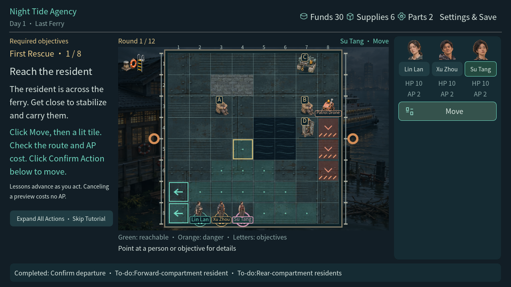
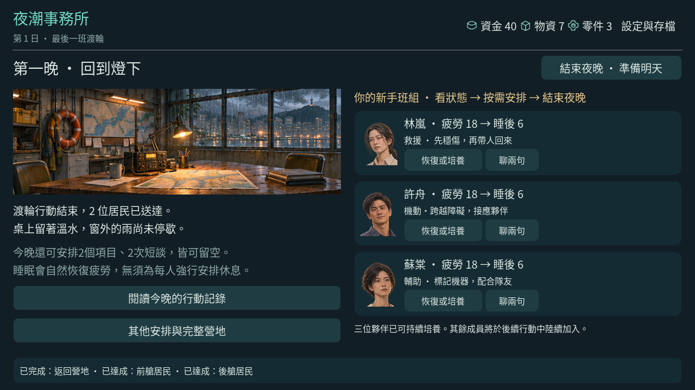
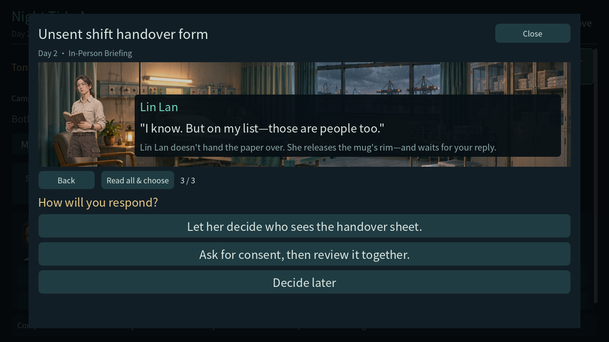

# 三种语言与 Qwen 配乐试作（2026-11-17）

用户确认先完成简体中文、繁体中文、英文，并提供阿里云业务空间用于配乐尝试。本轮仍是 P4 品质返修，不能将多语言接入或导出成功视为整款游戏达到发布质量。

启动页或设置与存档 → 语言 / Language 可切换简体中文、繁體中文、English。选择保存为独立界面偏好，重新启动沿用；战役存档、人物名字原始数据、目标 ID、剧情选择 ID 与冻结规则不改变。无需联网、模型账号或 API key 即可游玩全部语言。

两份翻译资源覆盖当前提取的 3601 条唯一源文案，包含现有 UI 资源、教学与战术展示、新增演出、冻结剧本与动态规则说明。Qwen Plus 初译、Qwen MT Plus 补译、人工编辑关键教学和剧情按钮；模型输出中夹杂中文、格式占位符不符的批次被拒绝并修正。另修正33条繁中文案中不应保留的简体字，并加入离线检查。文案数量包含内部设计描述，不能称为 3601 个玩家页面。没有对全部 96 个节点取得母语编辑逐句验收。

实际界面改动：英文教学精简为目的与操作；姓名避免拆成两行；地图用稳定字母对应目标，完整名称与状态保留在目标列表及指向提示；修复剧情说话人识别、英文标点过宽、动态带教条件和原始数据字段的漏译。剧情页减小导航与场景留白，720p 三种字号均完整显示两个回应及暂时搁置。原有逐项教学与获取顺序不变。

隐藏 GPU 与正式新周目路径的范围、检查和包证据见 validation.md。Windows 原生体验、新人学习节奏、全战役译文自然度、完整审美与性能验收仍未完成；P4-018-01继续打开。

配乐试作见 audio-model-review.json 和 audio-handoff.md。Fun-Music 返回 AccessDenied；Qwen Audio 成功生成 44.96 秒钢琴/弦乐候选。仅保留试听，不接入正式游戏。自动听辨不是人类听感验收，处理淡出也不是无缝循环制作。
