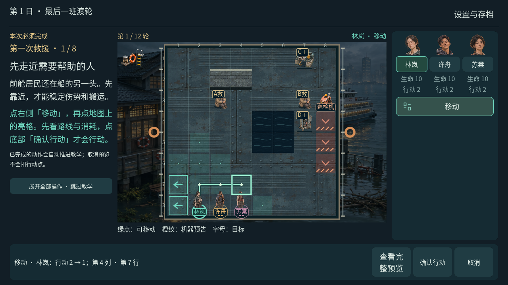
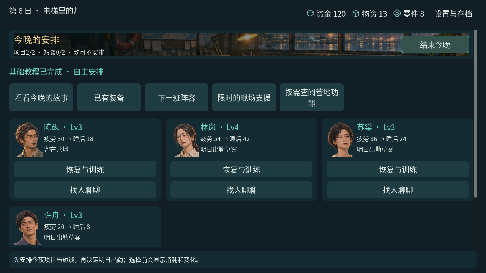
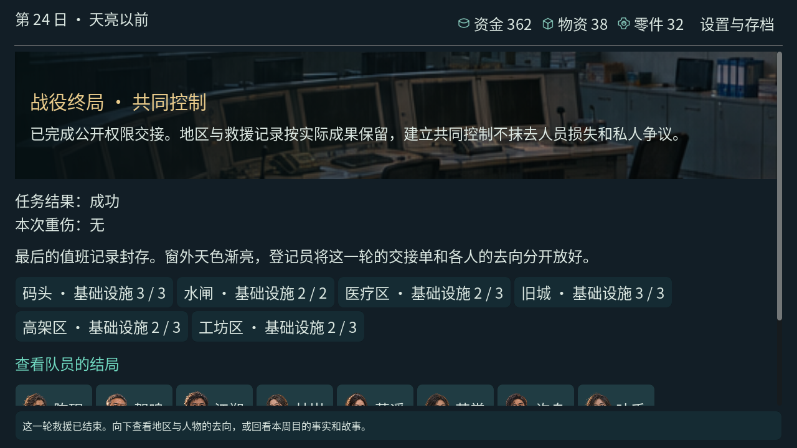

# 夜潮事务所 · 2026-11-19 发布候选

冻结的 0.18 仍是本包设计依据。正式玩法的变化集中在玩家能看见、能学到及能操作的部分。第六晚以后的推荐、JSON 读档后的战术屏障、现场提示、可选择的故事回应和营地确认窗都有实质修复。

## 从新周目到最后一天

一次标准难度简中周目从首战简报开始，经实际按钮、棋盘坐标和弹窗累计 2,041 次界面操作，经过 23 个夜晚到达总撤离结局。24 场主线有 23 场成功、1 场部分完成。脚本在后续战斗使用玩家也能点的“看看下一步怎么做”；该记录用于检查操作链与事实，整局好不好玩仍须玩家判断。

第一场救援选好移动后，棋盘保留整条路线，直到确认或取消。详细预览、岗位、普通出口和改派出口都使用与棋盘一致的 1 起始坐标。指向地格可查墙、深水、移动代价和出口。第一场先给救援所需的操作，资金与零件留到要用时展示。

第二场专心恢复诊所回路。第三场携带撬棍的人遇到合适障碍时才会得到工具说明。第四场的协作教学和第四晚的换人建立在真实出勤、入队时机上。学过的营地功能可以直接进入。第六晚读回自动存档后继续推荐，具备带教条件的队伍会得到与未建立关系的队伍不同的说明。第23晚可以从夜间总结直接选最终路线。确认时能看到路线名称和它对应的两项终战目标，取消后返回同一选择。

结算页将回营和可选支线放在当班结果旁。想核对资源、经验和人物反应时，可以打开完整结算。第20天择一保护避难所时，状态栏只列出这次确实保住的一处。失去前置条件的目标会标记失效；搬运中的目标定位跟着携带人走。普通恢复、紧急撤退、借调与基础行动仍可让低资源队伍走完整局。标题页的周目列表能找回其他周目的备份。即使活动周目只剩下手动槽备份，重新打开游戏仍能恢复，损坏原件会留存。

## 人与城市的收束

同一存档可以比较专长与普通方案。M08 叶禾隔离危险输出后，队员在下轮保住 10 点生命，普通方案剩 8 点。S08 江朔能隔两格把负载直接交给另一人，普通放下后负载仍在地面。这些结果要连同当时的等级、距离、队员投入与消耗一起看。

重伤、医疗离队、未立约及责任未查明的对白按本周目的事实呈现。已读回看使用打开故事时保存的演出。第20天东西避难所均完工时，结语会承认两处的成果。第24日先显示路线和现场结果，可以逐人打开生活、关系与履约记录，或回看章节。三语剧情有逐节点审读记录，并修复了大字号时选项或关闭按钮被挤出的问题。

## 画面与声音

标题和营地沿用事务所的夜灯与工作台。十二地点保留各自场景和地标，棋盘增加墙体明暗边缘并扩大可读区域。新灯具图标用于应用和启动画面。六个配乐场景已换为本项目通过百炼音频推理 API 制作并离线编辑的器乐。循环点写入资源，故事结束回营时接续离开前的乐句。24 个交互与现场短音继续使用原工程音源。

首战确认一度在开发机明显停顿。新周目现在利用阅读简报的时间后台加载渡轮棋盘的首次绘制资源。三次新进程的隐藏 720p 测量里，从合成鼠标确认到引擎画完首帧，修复前为 293～670 ms，修复后为 75～89 ms。实际显示与 Windows 系统延迟仍需设备测量。

Windows 目标硬件、五名新人和五份完整周目的真人结果仍需采集。验收条件、已知边界与操作方式见随包的 THIS-BUILD-REVIEW.md。当前发行判断为 **NO-GO**。
